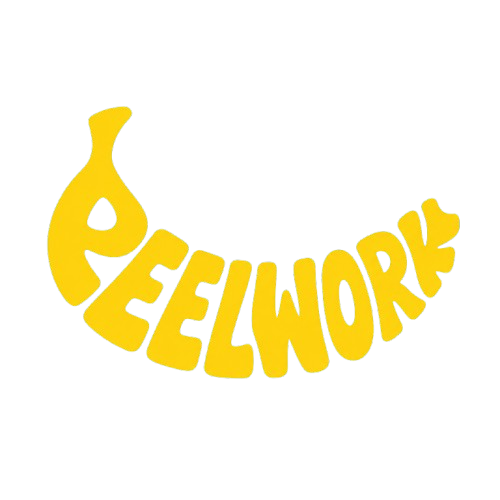
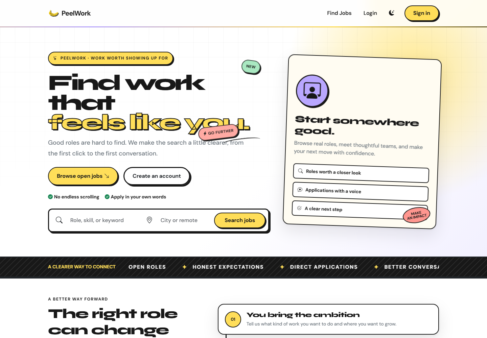
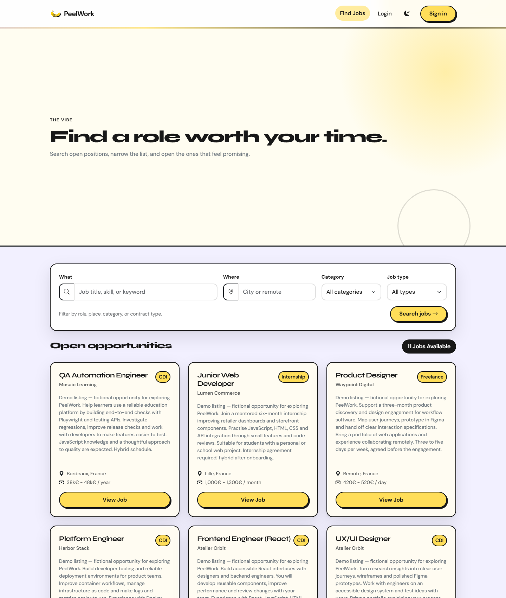
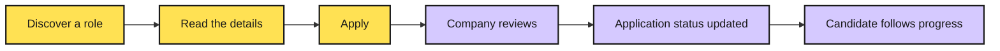
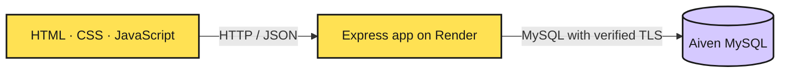

<div align="center">



# PeelWork

### Find work that feels like you.

A job marketplace with clear opportunities, direct applications, and a little more personality.

**[Explore the live app](https://peelwork.onrender.com/)** · **[Browse jobs](https://peelwork.onrender.com/jobs.html)** · **[Run locally](#run-locally)**


</div>

---

## A clearer way to connect

PeelWork brings the job search and hiring workflow into one small, focused app. Candidates explore roles, introduce themselves, and follow their applications. Companies publish opportunities and manage their own hiring pipeline. Super admins keep the marketplace organised.

Built with Express, MySQL, and vanilla JavaScript, with a bold yellow visual identity, rounded cards, dark outlines, and light and dark themes.

> **Demo project:** the live marketplace includes fictional companies and sample job listings. It is an MVP for exploring the experience, with the limitations documented below.

## Take a look

### The first impression



### The job board

Search by keyword and location, filter by category or contract type, and open a role to see the full details.



<sub>Screenshots captured from the live public app in November 2026. Listings may change.</sub>

## One marketplace, three perspectives

| For candidates | For companies | For super admins |
| :--- | :--- | :--- |
| Search and filter open roles | Create, edit, and remove listings | View companies and marketplace listings |
| Read job and company details | Maintain a company profile | Create a company and its first admin together |
| Apply as a guest or registered user | Review applications with candidate context | Edit or remove listings across companies |
| Build a profile with skills and experience | Filter the application pipeline | Keep company access organised |
| Track application statuses | Mark applications reviewed, accepted, or rejected | Access a dedicated administration dashboard |

### From discovery to decision



Registered candidates can track applications in their dashboard. Guest applications reach the company inbox but do not have a candidate dashboard.

## Under the hood



Express serves the public pages and API. Search filters run in SQL, and company access is scoped to the signed-in account. Public pages include SEO metadata; individual jobs include structured data, and `/sitemap.xml` is generated from the database.

## Run locally

You need a current Node.js LTS release, npm, and MySQL. Bootstrap, icons, and web fonts require internet access.

### 1. Install and configure

```sh
git clone https://github.com/Abduu898/PeelWork.git
cd PeelWork
npm ci
cp .env.example .env
```

Edit `.env` with your own database connection details. For local development, set `SITE_URL=http://localhost:3000` and leave `DB_SSL=false` unless your MySQL server requires TLS.

### 2. Initialise a local database

> **Use a disposable development database.** `schema.sql` drops and recreates the `hireloop` database. Never run it against your hosted database or data you want to keep.

From the project directory, open the MySQL client:

```sh
mysql -u root -p
```

Then run:

```sql
SOURCE schema.sql;
SOURCE seed.sql;
EXIT;
```

The seed creates sample companies, categories, jobs, and development accounts. Login credentials are intentionally omitted from this README. Register a candidate through the app, or use an administrator account you control to create company access.

<details>
<summary><strong>Upgrading an older database?</strong></summary>

Back up the database and inspect its schema first. If the corresponding fields are missing, run the applicable migrations from the MySQL client:

```sql
USE hireloop;
SOURCE migrations/001_candidate_profiles.sql;
SOURCE migrations/002_company_profiles.sql;
```

A fresh database created from the current `schema.sql` already includes these fields.

</details>

### 3. Start the app

```sh
npm start
```

Open **[localhost:3000](http://localhost:3000/)**. Keep the server running while using the app.

| Command | Purpose |
| :--- | :--- |
| `npm start` | Run the integrated web app and API; defaults to port 3000 |
| `npm run dev` | Run a separate frontend preview on port 5173; keep `npm start` running for API access |
| `npm test` | Run the existing Node test suite; see the testing note below |

## Deploy with Render + Aiven

On Render, use `npm ci` as the build command and `npm start` as the start command. The server honours Render's `PORT` environment variable.

Configure these environment variables through your hosting settings:

| Variable | Purpose |
| :--- | :--- |
| `DB_HOST`, `DB_PORT` | Aiven MySQL endpoint and port |
| `DB_USER`, `DB_PASSWORD`, `DB_NAME` | Database login and database name |
| `DB_SSL` | Set to `true` for the hosted TLS connection |
| `DB_SSL_CA_PATH` | Path to the Aiven CA certificate, such as `/etc/secrets/ca.pem` on Render |
| `DB_SSL_CA` | Alternative to a certificate file: the complete PEM certificate |
| `SITE_URL` | Public HTTPS origin, used for generated crawler URLs |

Upload the Aiven CA certificate as a Render secret file, or configure `DB_SSL_CA`. Certificate verification stays enabled.

For a **brand-new, empty hosted database**, the setup helper creates the schema and sample data without dropping a database:

```sh
node scripts/setup-hosted-db.js .env.deploy
```

It refuses to initialise a database that already contains tables, generates random account passwords, and saves them to a local Git-ignored file. Keep connection files and generated account credentials private.

## Project map

```text
PeelWork/
├── index.html                Homepage
├── jobs.html                 Searchable job board
├── job-detail.html           Role details and application form
├── login.html                Login and candidate registration
├── candidate-dashboard.html  Candidate profile and applications
├── admin.html                Company profile, jobs, and inbox
├── super-admin.html          Marketplace administration
├── server.js                 Express routes, sessions, and access control
├── db.js                     MySQL pool and TLS configuration
├── css/                      Shared visual system and themes
├── js/
│   ├── components/           Navigation, cards, and reusable UI
│   ├── pages/                Page controllers
│   └── services/             API and authentication helpers
├── migrations/               Changes for older database schemas
├── scripts/                  Preview and database setup utilities
├── docs/                     Screenshots and frontend roadmap
├── tests/                    Frontend tests
├── schema.sql                Canonical development schema
└── seed.sql                  Local development sample data
```

<details>
<summary><strong>API at a glance</strong></summary>

| Area | Routes |
| :--- | :--- |
| Discovery | `GET /ads`, `GET /ads/:id`, `GET /categories` |
| Applications | `POST /ads/:id/applications` |
| Authentication | `POST /auth/register/candidate`, `POST /auth/login`, `POST /auth/logout` |
| Candidate | `GET/PUT /me/profile`, `GET /me/applications` |
| Company | `GET/PUT /company/profile`, `GET/POST /company/ads`, `PUT/DELETE /company/ads/:id` |
| Company inbox | `GET /company/applications`, `PATCH /applications/:id/status` |
| Super admin | `GET/POST /admin/companies`, `GET /admin/ads`, `PUT/DELETE /admin/ads/:id` |
| Crawlers | `GET /robots.txt`, `GET /sitemap.xml` |

Protected routes use a bearer token returned by login. The server enforces role and company ownership checks.

</details>

## Try the complete flow

1. Search for a role and open its details.
2. Register or sign in as a candidate, complete your profile, and apply.
3. Check the application in your candidate dashboard.
4. Sign in as the matching company admin and review the application.
5. Change its status and confirm the candidate sees the update.

**Testing note:** the existing frontend tests still assume sample-data responses and do not mock the current API-based services. `npm test` needs those tests updated before it can serve as a passing automated check; starting the server alone does not fix Node's handling of API-relative URLs.

## What is still MVP-level

- **Sessions:** stored in memory and cleared on restart; the browser keeps the token in `localStorage`.
- **Password storage:** currently SHA-256. A production authentication system should use Argon2 or bcrypt with appropriate session handling.
- **Resumes:** file selection validates and displays the filename; files are not uploaded or stored.
- **Guest applications:** delivered to companies without candidate-dashboard tracking.
- **External assets:** styles, icons, and fonts depend on CDN availability.

See the [frontend roadmap](docs/frontend-roadmap.md) and [security policy](SECURITY.md) for more context.

## Contributing

Keep changes focused, check the affected user flow, and include screenshots for interface changes. Never commit environment files, database credentials, or generated account passwords.

Released under the [MIT License](LICENSE).

---

<div align="center">

**Good roles. Thoughtful teams. A clear next step.**

[Explore PeelWork →](https://peelwork.onrender.com/)

</div>
